# Air Quality Index (AQI) Prediction using Machine Learning 

**Name:** Aayushi  |  **Roll No:** 22515000005  |  **Course:** B.Tech CSE – Data Science Project

---

## 1. Problem Statement
Air pollution is a major public-health problem in many Indian cities. This project analyses daily pollutant data and builds a machine-learning model that **predicts the next-day AQI** and converts it into a **health-risk category** (Low / Moderate / High / Severe), so that people can be warned in advance.

The pipeline is **city-independent** (the city is a single variable `CITY` in the code). For model building and demonstration, **Delhi is used as a case study** because it has long, continuous records and strong seasonal pollution patterns.

## 2. Dataset
- **Source:** Air Quality Data in India (daily city-wise data), file `city_name.csv`
- **Subset used:** City = Delhi (case study, selected via `CITY = "Delhi"`), sorted by date
- **Target:** `AQI`
- **Features:** PM2.5, PM10, NO, NO2, NOx, NH3, CO, SO2, O3 + date
- **Rows (Delhi, raw):** 2009 rows × 16 columns, from 01-01-2015 to 01-07-2020
- **Rows after cleaning and feature engineering:** 1992 (1593 train / 399 test)

## 3. Project Structure
```
├── README.md                 # this report
└── code/
    ├── aqiverse_part1.py     # complete code (EDA + preprocessing + model)
    ├── city_name.csv         # dataset
    ├── cleaned_data.csv      # cleaned data (generated)
    ├── delhi_cleaned.csv     # cleaned data of Delhi (generated)
    ├── model_results.csv     # model metrics (generated)
    └── images/               # all graphs used in this report
```
Run: `pip install numpy pandas matplotlib seaborn scikit-learn` then, from inside the `code` folder, `python aqiverse_part1.py`

---

## 4. Exploratory Data Analysis (EDA)

### 4.1 Missing values
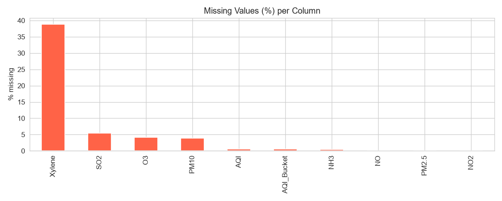

Xylene has the most missing values (about 38.9%), followed by SO2 (5.5%), O3 (4.2%) and PM10 (3.8%); the other columns have almost none. Xylene is not used as a feature. 10 rows were removed in total (missing AQI / duplicates). Rows where the **target (AQI) is missing were dropped**, because we cannot learn from unlabelled rows. Duplicate rows were also dropped.

### 4.2 AQI distribution
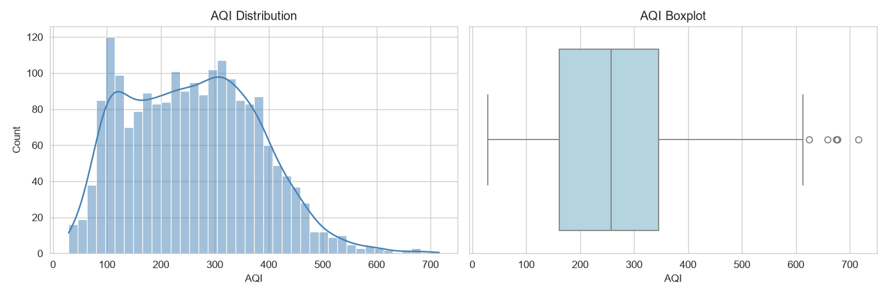

The AQI distribution is right-skewed: most days are moderate, but there is a long tail of very high AQI days. The boxplot confirms many high-value points.

> The graphs below are generated for the selected case-study city (Delhi).

### 4.3 AQI trend over time
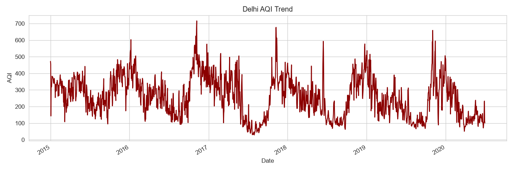

AQI shows clear repeating peaks every year, which means the data has strong **seasonality**.

### 4.4 Monthly and yearly pattern
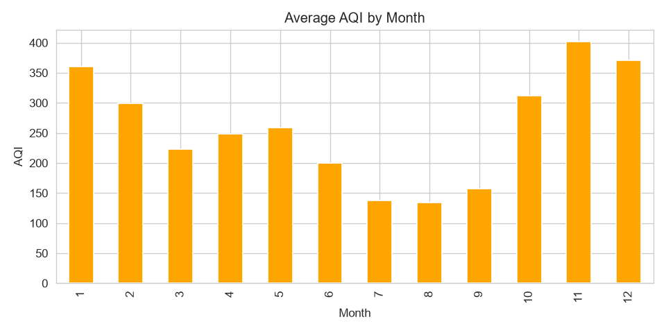 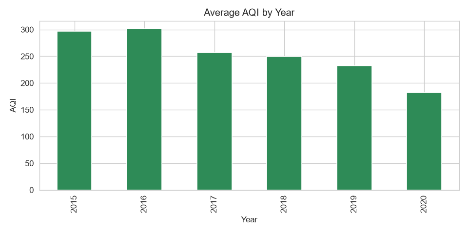

AQI is highest in **Oct–Jan** (crop-residue burning, Diwali, cold temperature, low wind) and lowest in **Jul–Sep** (monsoon rain washes pollutants away). Because of this, `month` is a useful feature.

### 4.5 Season-wise AQI
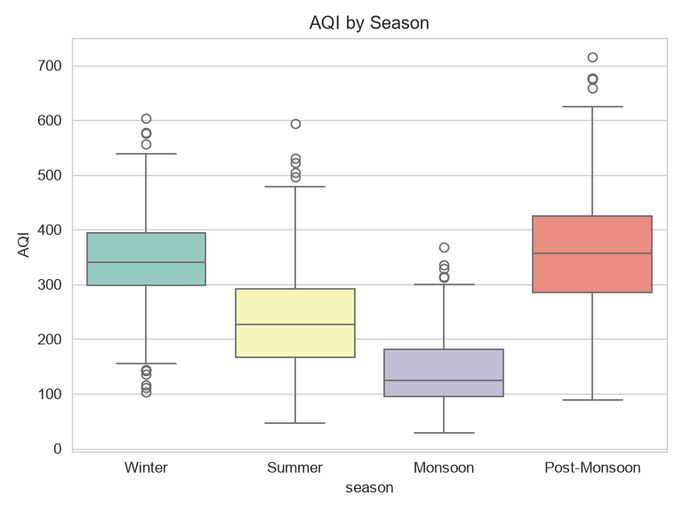

Winter and Post-Monsoon have the highest median AQI; Monsoon has the lowest.

### 4.6 Correlation between pollutants
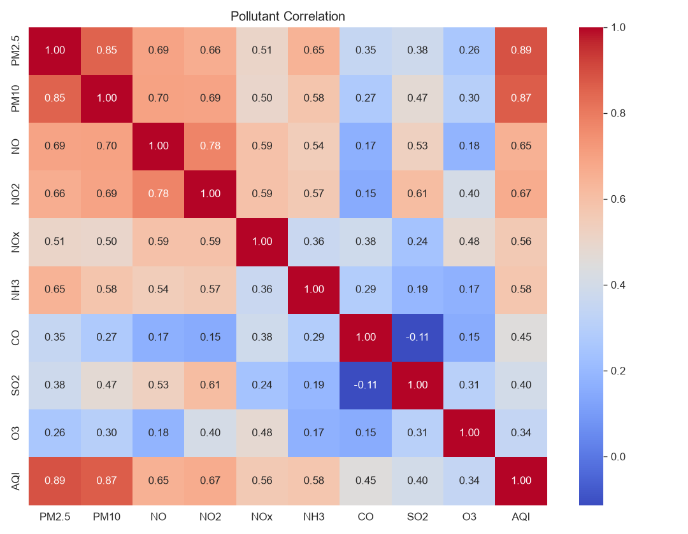

PM2.5 and PM10 have the strongest correlation with AQI, because AQI in India is mostly driven by particulate matter. NO, NO2 and NOx are also strongly correlated with each other (multicollinearity).

---

## 5. Preprocessing

| Step | Technique | Why |
|---|---|---|
| Missing target | Drop rows with no AQI | Cannot train without label |
| Duplicates | `drop_duplicates()` | Avoid biased training |
| Outlier detection | **IQR rule** (k = 3) on all pollutants | Find extreme / sensor-error values |
| Outlier removal | Outlier values removed (set to NaN) | Remove noise |
| Missing values | **Time-based interpolation** + bfill/ffill | Fills gaps and removed outliers without breaking the daily time series |
| Feature engineering | Lag-1, Lag-7, 7-day rolling mean, PM lags, month, day of week | Past AQI is the best predictor of tomorrow's AQI |
| Encoding | **One-hot encoding** of `season` (Winter / Summer / Monsoon / Post-Monsoon) | Models need numeric input |
| Scaling | **StandardScaler** (mean 0, std 1) | Features are on very different scales; needed for Linear Regression |
| Split | **Time-based 80/20** split (no shuffle) | Prevents using future data to predict the past |

### 5.1 Outlier detection and removal
Boxplots **before** treatment (many extreme points):

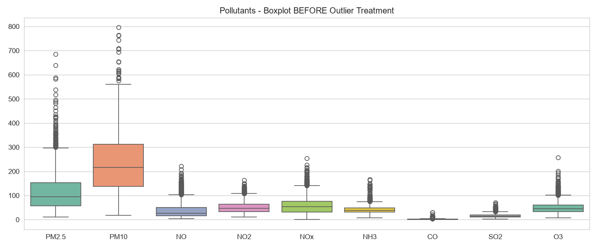

Number of outliers detected per pollutant (IQR, k = 3): CO 163, NH3 24, O3 20, NO 19, SO2 16, PM2.5 11, NOx 4, NO2 1, PM10 0. CO has by far the most extreme values, because its readings are highly right-skewed.

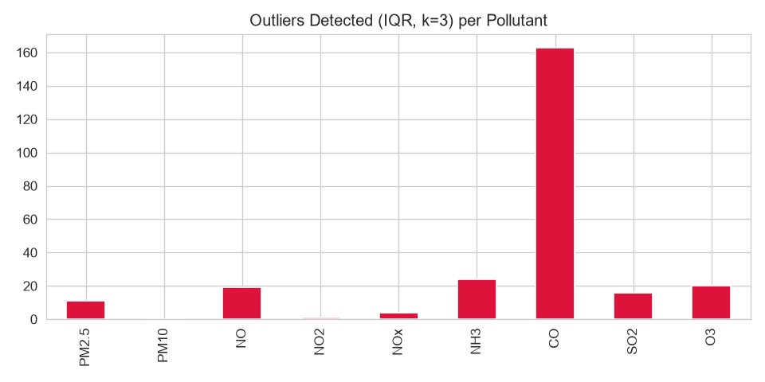

Boxplots **after** treatment:

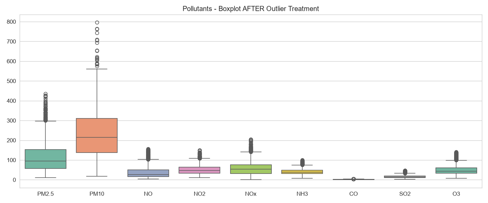

**Note:** A wider threshold (k = 3 instead of the usual 1.5) was used on purpose. Indian cities such as Delhi have genuinely severe pollution days, and the usual 1.5×IQR rule would delete real events. Outlier values were replaced by interpolation instead of deleting full rows, so the daily sequence (needed for lag features) stays intact. AQI (target) was not altered.

### 5.2 Scaling
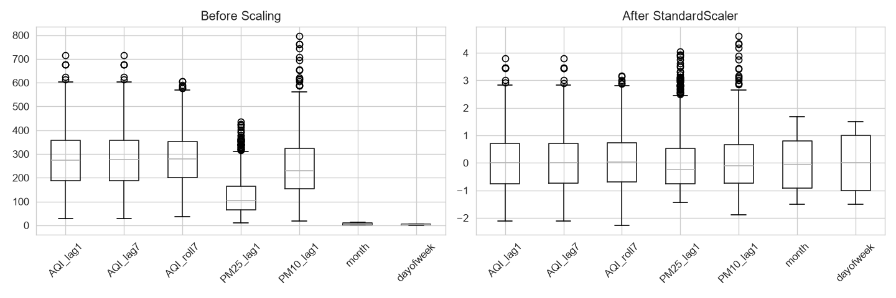

The scaler is **fitted only on the training data** and applied to test data, inside an sklearn `Pipeline`, to avoid data leakage.

### 5.3 Encoding
`month` → season → one-hot columns (`season_Monsoon`, `season_Post-Monsoon`, `season_Summer`; Winter is the dropped reference category).

---

## 6. Baseline Modelling
Two models were trained on the scaled features: **Linear Regression** (baseline) and **Random Forest** (200 trees).

| Model | MAE | RMSE | R² |
|---|---|---|---|
| Linear Regression | 30.73 | 40.84 | 0.871 |
| Random Forest | 27.20 | 37.93 | 0.889 |

Random Forest performs better than the baseline on all three metrics (lower MAE and RMSE, higher R²). Its predictions are on average about 27 AQI points away from the actual value.

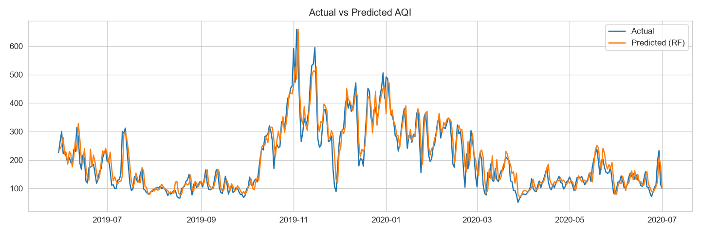
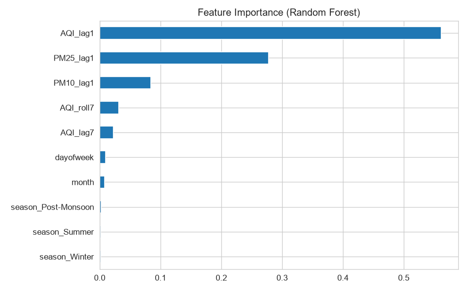

The most important features are `AQI_lag1` and `AQI_roll7`, i.e. recent AQI history, followed by PM2.5/PM10 lags.

## 7. Health Risk Classification
Predicted AQI is mapped to a risk level:

| AQI | Risk |
|---|---|
| 0–100 | Low |
| 101–200 | Moderate |
| 201–300 | High |
| > 300 | Severe |

## 8. Conclusion and Future Work
- EDA (on the Delhi case study) showed strong seasonality (winter peaks) and PM2.5/PM10 as the main drivers of AQI.
- Preprocessing (outlier treatment, interpolation, encoding, scaling) produced a clean, model-ready dataset.
- Random Forest with lag features gives a good next-day AQI forecast.
- **Future work:** run the same pipeline on all cities and compare, hyperparameter tuning, XGBoost/LSTM, weather features (temperature, wind, humidity), and a deployed web app.
